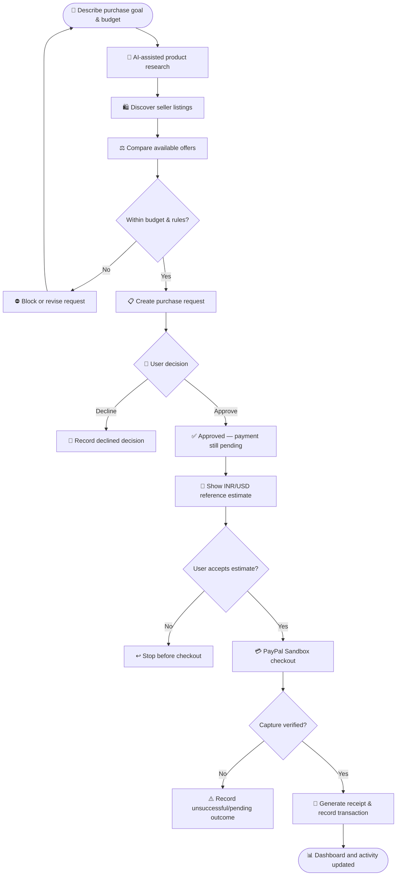
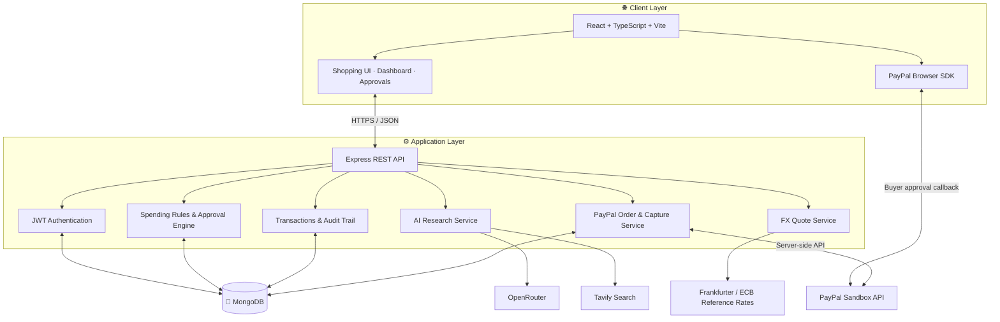
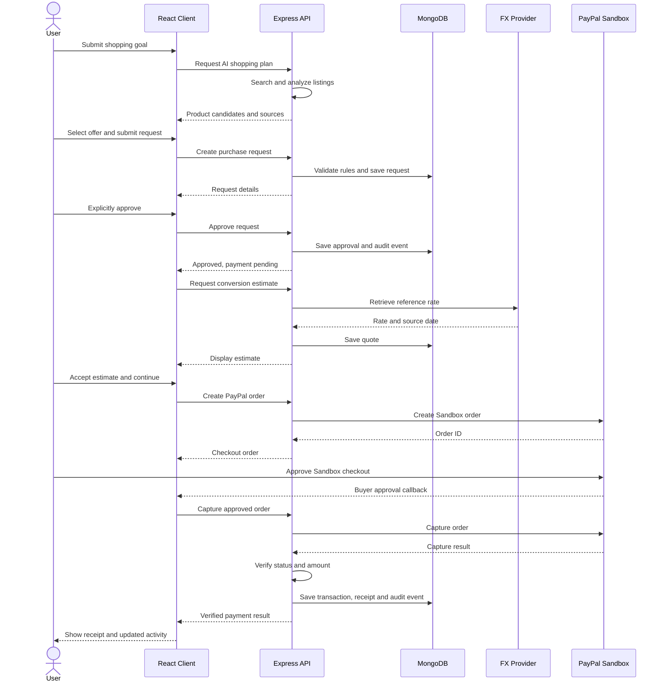

<div align="center">

# ✦ PayPilot AI

### Your AI shopping copilot. Your budget. Your final decision.

**An AI-assisted purchasing command center built around transparent research, budget guardrails, explicit human approval, and verified sandbox payments.**

<p>
  <a href="https://github.com/madupojumounika/paypilot"></a>
  
  
  
  
  
  
</p>

<p>
  <a href="#-overview">Overview</a> •
  <a href="#-features">Features</a> •
  <a href="#-how-it-works">Workflow</a> •
  <a href="#-architecture">Architecture</a> •
  <a href="#-getting-started">Get Started</a> •
  <a href="#-api-reference">API</a> •
  <a href="#-security--payment-safety">Safety</a>
</p>

</div>

---

## 🧭 Overview

Online shopping can involve multiple tabs, uncertain listings, hidden costs, and decisions that are difficult to track. **PayPilot AI** brings the research-to-purchase journey into one guided experience.

A user describes a purchase goal and budget. PayPilot assists with product research, discovers seller listings, compares available offers, applies spending rules, and presents a purchase for explicit approval. If the user proceeds, the application can demonstrate the payment flow using **PayPal Sandbox**.

> [!IMPORTANT]
> **Human approval is the final gate.** PayPilot can research and recommend, but it does not autonomously authorize or capture a payment. Approving a purchase request and completing a payment are separate steps.

<div align="center">

| 🤖 AI-assisted research | 🛡️ Budget guardrails | 👤 Human approval | 💳 Sandbox verification |
|:---:|:---:|:---:|:---:|
| Discover and compare | Check spending rules | User decides | Test payment flow |

</div>

## ✨ Features

<table>
<tr>
<td width="50%" valign="top">

### 🔎 Intelligent product research
- Natural-language shopping goals
- OpenRouter-powered research and analysis
- Tavily web search for seller discovery
- Product-to-listing relevance checks
- Source and seller links for review

</td>
<td width="50%" valign="top">

### ⚖️ Offer comparison
- Compare available seller offers
- Display INR prices when extractable from seller pages
- Check offers against the requested budget
- Avoid inventing missing seller prices
- Review listing details before proceeding

</td>
</tr>
<tr>
<td width="50%" valign="top">

### 🛡️ Spending controls
- Monthly budget tracking
- Configurable spending rules
- Backend-side purchase checks
- Approval queue for purchase requests
- Decision and activity history

</td>
<td width="50%" valign="top">

### 👤 Human-in-the-loop approvals
- Review product, seller, and amount
- Explicit approve or decline action
- Approval creates a pending-payment record
- Payment is a separate user-authorized step
- Purchase decisions recorded in an audit trail

</td>
</tr>
<tr>
<td width="50%" valign="top">

### 💳 PayPal Sandbox integration
- PayPal Checkout Orders v2
- Server-side order creation
- Capture status and amount verification
- INR-to-USD reference estimate
- Receipt generation after completed capture

</td>
<td width="50%" valign="top">

### 📊 Account dashboard
- Spending and budget overview
- Saved products
- Pending approvals
- Recent transactions
- Activity and audit history
- Responsive interface and light/dark themes

</td>
</tr>
</table>

## 🔄 How it works

The application follows a controlled sequence. Each stage has a clear responsibility, and the user remains in charge of the purchase.



### Workflow principles

1. **Research is not authorization.** AI output is presented as information for the user to evaluate.
2. **Approval is not payment.** An approved request remains pending until the separate checkout process is completed.
3. **The backend validates important decisions.** Spending rules, budget checks, quote acceptance, and payment capture are not trusted solely to browser state.
4. **Payment status is verified.** The API checks PayPal's capture result and expected amount before treating a payment as completed.

## 🏗️ Architecture

PayPilot uses a React frontend, an Express REST API, MongoDB persistence, and external services for AI research, web search, currency reference data, and sandbox payment processing.

### High-level system architecture



### Component responsibilities

| Component | Responsibility |
|---|---|
| **React + TypeScript** | User interface, product exploration, dashboard, approval and activity screens |
| **Express API** | Application endpoints, validation, orchestration and business logic |
| **JWT middleware** | Protect account-specific API routes |
| **MongoDB + Mongoose** | Persist users, rules, approvals, saved products, quotes, transactions and audit events |
| **OpenRouter** | AI-assisted product research and analysis |
| **Tavily** | Web search and seller-page discovery |
| **Frankfurter / ECB reference rates** | Provide the reference-rate data used for INR-to-USD estimates |
| **PayPal Sandbox** | Demonstrate order creation, buyer approval, capture verification and test receipts |

### Backend request and payment sequence



## 🧰 Technology stack

<div align="center">

| Frontend | Backend & Data | Integrations |
|:---:|:---:|:---:|
| React 18 | Node.js 20+ | OpenRouter |
| TypeScript | Express 4 | Tavily |
| Vite | MongoDB | PayPal Sandbox |
| Framer Motion | Mongoose | Frankfurter / ECB rates |
| Lucide React | JWT + bcrypt | Google Identity Services (optional) |
| Recharts | Helmet, CORS, rate limiting | |

</div>

## 🚀 Getting started

### Prerequisites

- **Node.js 20+** and npm
- **MongoDB** Atlas connection or local MongoDB deployment
- API credentials for the integrations you want to run

### 1. Clone the repository

```bash
git clone https://github.com/madupojumounika/paypilot.git
cd paypilot
```

### 2. Install packages

```bash
npm install
```

### 3. Configure environment variables

Create your local environment file:

```bash
cp .env.example .env
```

For Windows PowerShell:

```powershell
Copy-Item .env.example .env
```

Update the values in `.env`:

| Variable | Used for | Required when |
|---|---|---|
| `PORT` | API port (default `4000`) | API server |
| `CLIENT_ORIGIN` | Allowed frontend origin | API server |
| `VITE_API_URL` | Frontend API base URL | Frontend |
| `MONGODB_URI` | MongoDB connection | Persistent data |
| `JWT_SECRET` | Signing authentication tokens | Account authentication |
| `OPENROUTER_API_KEY` | AI research | AI shopping research |
| `OPENROUTER_MODEL` | Model selection | AI shopping research |
| `TAVILY_API_KEY` | Web search | AI shopping research |
| `PAYPAL_CLIENT_ID` | PayPal app client ID | Sandbox checkout |
| `PAYPAL_CLIENT_SECRET` | PayPal app secret | Sandbox checkout |
| `PAYPAL_ENVIRONMENT` | Set to `sandbox` | PayPal integration |
| `VITE_PAYPAL_CLIENT_ID` | Browser PayPal SDK client ID | Sandbox checkout |
| `VITE_GOOGLE_CLIENT_ID` | Google web client ID | Optional Google sign-in |
| `GOOGLE_CLIENT_ID` | API-side Google audience validation | Optional Google sign-in |

> 🔐 Keep secrets in the server-side `.env` file or deployment secret manager. Never commit real credentials or expose private keys through `VITE_*` variables.

### 4. Start the backend

Open a terminal:

```bash
npm run server:dev
```

The API runs at `http://localhost:4000` by default.

### 5. Start the frontend

Open a second terminal:

```bash
npm run dev
```

Open the local URL printed by Vite, usually:

```text
http://localhost:5173
```

### 6. Optional: Configure Google sign-in

1. Create a Web OAuth Client ID in Google Cloud Console.
2. Add your local and deployed frontend origins to **Authorized JavaScript origins**.
3. Set the same client ID as `VITE_GOOGLE_CLIENT_ID` and `GOOGLE_CLIENT_ID`.
4. Restart the frontend and API.

Google sign-in is displayed only when the frontend client ID is configured. The backend verifies the ID token and its audience.

## 📡 API reference

Protected account endpoints require:

```http
Authorization: Bearer <token>
```

| Method | Endpoint | Description |
|---|---|---|
| `GET` | `/api/health` | API health and integration status |
| `POST` | `/api/auth/register` | Register an account |
| `POST` | `/api/auth/login` | Email/password login |
| `POST` | `/api/auth/google` | Verify Google identity token |
| `GET`, `PATCH` | `/api/auth/me` | Read/update signed-in profile |
| `GET`, `POST` | `/api/rules` | List/create spending rules |
| `PATCH`, `DELETE` | `/api/rules/:id` | Update/delete a spending rule |
| `GET`, `POST` | `/api/approvals` | List/create purchase requests |
| `PATCH` | `/api/approvals/:id` | Approve or decline a request |
| `GET` | `/api/transactions` | List transaction activity |
| `GET` | `/api/audit` | Read purchase and payment audit events |
| `POST` | `/api/fx/quotes` | Create INR-to-USD reference estimate |
| `POST` | `/api/fx/quotes/:id/accept` | Record explicit quote acceptance |
| `POST` | `/api/paypal/orders` | Create PayPal Sandbox order |
| `POST` | `/api/paypal/capture` | Capture and verify Sandbox payment |
| `GET` | `/api/paypal/receipt/:transactionId` | Retrieve verified payment receipt |
| `POST` | `/api/assistant/plan` | AI-assisted shopping research |
| `GET`, `POST` | `/api/saved-products` | List/save products |
| `DELETE` | `/api/saved-products/:id` | Remove a saved product |

The AI shopping research endpoint is guest-accessible and rate-limited. Account, spending, approval, saved-product, and transaction data are protected by authentication.

## 🧪 Scripts and checks

| Command | Description |
|---|---|
| `npm run dev` | Start Vite development server |
| `npm run build` | Run TypeScript checks and build frontend |
| `npm run preview` | Preview production frontend build |
| `npm run server:dev` | Start API with Node watch mode |
| `npm run server:start` | Start API |
| `npm run check:server` | Run backend syntax checks |
| `npm run test:server` | Run backend tests |

## 🔒 Security & payment safety

- **Sandbox-only payment integration:** The project is configured for PayPal Sandbox testing, not live payment processing.
- **No autonomous payment capture:** The AI cannot approve or capture payments on behalf of the user.
- **Server-side verification:** PayPal order creation and capture are performed by the API. The backend verifies the completed capture and expected USD amount before issuing a receipt.
- **Separate approval and payment:** An approved purchase request is stored as `approved_pending_payment`; this is not a completed transaction.
- **Spending validation:** Purchase requests are checked against enabled spending rules and monthly budget constraints.
- **Quote transparency:** The INR-to-USD figure is an ECB reference-rate estimate, not a guaranteed PayPal, card, or bank exchange rate.
- **Secret handling:** Database credentials, JWT secrets, AI keys, and PayPal secrets must remain server-side.
- **API protections:** Helmet, CORS allow-listing, request-size limits, and authentication rate limiting are included.

### Important demo limitations

> [!WARNING]
> PayPal Sandbox simulates a payment to the configured **PayPilot Sandbox merchant**. It does **not** place an order with Flipkart, Amazon, or another retailer, and it does not charge real money.

Seller-page extraction can be limited or change over time. A displayed listing does not guarantee stock, shipping, warranty, delivery time, or the final merchant checkout price. Users should confirm all final details on the retailer's website.

## 🗂️ Project structure

```text
paypilot/
├── src/
│   ├── App.tsx                 # Main React application and screens
│   ├── main.tsx                # Frontend entry point
│   ├── index.css               # Global styles and themes
│   ├── types.ts                # Shared TypeScript types
│   ├── hooks/
│   │   └── usePersistentState.ts
│   └── lib/
│       └── api.ts              # Frontend API client
├── server/
│   └── src/
│       ├── app.js              # Express app and route registration
│       ├── index.js            # API entry point
│       ├── config/
│       │   └── db.js           # MongoDB connection
│       ├── middleware/
│       │   └── auth.js         # JWT authentication
│       ├── models/             # Mongoose data models
│       └── routes/             # Auth, rules, approvals, AI, FX, PayPal, etc.
├── .env.example                # Environment variable template
├── package.json
└── README.md
```

## 🛣️ Project status

PayPilot AI is a **working prototype** demonstrating an AI-assisted shopping research and approval workflow with PayPal Sandbox payment verification.

| Area | Implementation |
|---|---|
| Product research and seller discovery | Implemented; depends on configured AI/search services and accessible seller pages |
| Budget rules and approval flow | Implemented in frontend and API |
| Account authentication and persistence | Implemented; requires MongoDB configuration |
| Currency reference estimate | Implemented; not a locked checkout conversion |
| PayPal order and capture flow | Implemented for Sandbox; requires Sandbox credentials |
| Receipt and transaction history | Implemented for verified completed Sandbox captures |

A successful frontend build or API test suite does not replace end-to-end testing with configured MongoDB, AI-search, and PayPal Sandbox credentials.

## 🔮 Future improvements

- Broader retailer coverage and resilient seller-page parsing
- More detailed landed-cost comparison, including shipping and taxes where available
- Additional approval policies and configurable spending limits
- Automated integration and end-to-end test coverage
- Production-grade monitoring and deployment hardening

## 🤝 Contributing

Suggestions, bug reports, and improvements are welcome. For substantial changes, open an issue first to discuss the proposed approach, then submit a pull request with a clear description and test notes.

## 📄 License

No open-source license has been added to this repository yet. Unless a license is added, the project remains under its owner's default copyright.

---

<div align="center">

### Built around one simple promise

## AI can help you decide. You decide whether to pay.

**PayPilot AI · Research clearly. Spend consciously. Stay in control.**

</div>
